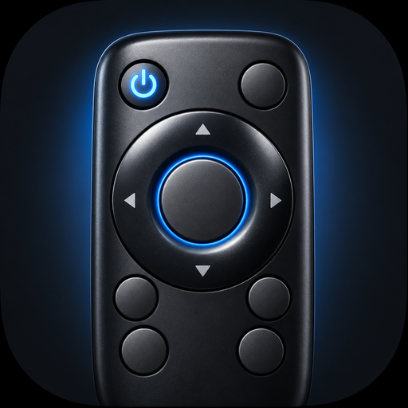
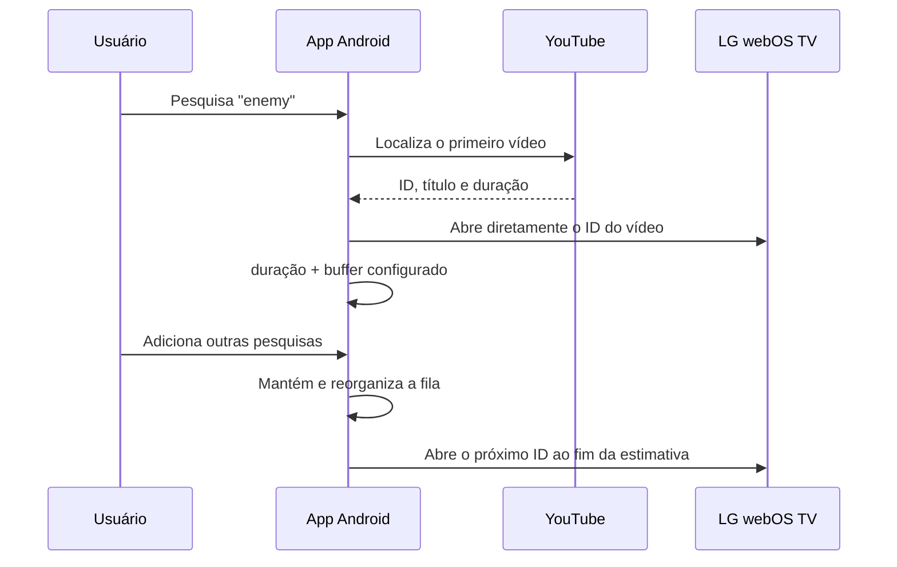

<p align="center">
  
</p>

<h1 align="center">Controle TV — LG webOS</h1>

<p align="center">
  Controle remoto Android, local e sem anúncios para TVs LG webOS.<br>
  Navegação, touchpad, apps, entradas, pesquisa no YouTube e fila automática de vídeos.
</p>

<p align="center">
  
  
  
  
  
</p>

> [!IMPORTANT]
> Este é um projeto independente e não oficial. Não possui vínculo com LG Electronics, Google ou YouTube.

## Destaques

- conexão local por **SSAP**, sem servidor intermediário e sem conta LG;
- descoberta automática da TV por SSDP ou conexão manual por IP;
- D-pad circular, OK, Voltar, Início, menu, volume, mudo e energia;
- touchpad de tela inteira para controlar o cursor da TV;
- lista de aplicativos com ícones reais, favoritos configuráveis e entradas HDMI;
- pesquisa do YouTube pelo celular e abertura direta do primeiro vídeo encontrado;
- **fila automática** com contador, botão de pular, remoção e reordenação;
- buffer configurável entre vídeos, de 0 a 30 segundos;
- Wake-on-LAN para ligar modelos configurados para despertar pela rede;
- leitura/captura da tela e controles de imagem quando liberados pelo firmware;
- chave de pareamento protegida pelo Android Keystore;
- interface nativa em Kotlin com Jetpack Compose.

## Como a pesquisa e a fila funcionam



A TV não fornece ao controle o ID, a posição nem o evento de término do vídeo atual. Por isso, o app descobre o vídeo pelo celular e calcula a troca usando a duração publicada mais o buffer escolhido em **Configurações → YouTube**.

A consulta de pesquisa é *best effort* e não usa uma chave privada de API. Caso o formato público do YouTube mude, o app tenta voltar ao fluxo de abrir os resultados na TV e pressionar OK.

## Compatibilidade

### Ambiente realmente testado

| Item | Versão testada |
|---|---|
| TV | **LG 43UP7500PSF** |
| Plataforma | **webOS TV 6.x — geração 2021** |
| Firmware | **03.53.45** |
| Transporte | WSS/SSAP na porta 3001 |
| Android | Android 8.0 ou superior (`minSdk 26`) |

Nesse conjunto foram validados pareamento, reconexão, navegação, volume, apps, HDMI, touchpad, captura de tela, Wake-on-LAN, pesquisa direta no YouTube e fila.

### Versões que provavelmente funcionam

| webOS TV | Expectativa | Observação |
|---|---|---|
| **6.x (2021)** | ✅ Testado | Modelo e firmware acima |
| **22 a 26 (2022–2026)** | 🟢 Alta para o controle básico | Permissões, nomes de apps e serviços internos podem variar |
| **4.x e 5.x (2018–2020)** | 🟡 Provável | SSAP é amplamente usado, mas WSS e recursos de imagem podem variar |
| **3.x (2016–2017)** | 🟠 Possível | Requer teste real; alguns comandos modernos podem não existir |
| **1.x e 2.x (2014–2015)** | ⚪ Desconhecida | Não testado e sem garantia de transporte/manifesto compatível |

A LG mantém gerações distintas de webOS TV desde 1.x até 26; a tabela oficial relaciona as versões aos respectivos anos. Isso não garante que todos os endpoints privados sejam iguais. Consulte a [matriz detalhada](docs/COMPATIBILIDADE.md) e a [tabela oficial de plataformas da LG](https://webostv.developer.lge.com/develop/specifications/web-api-and-web-engine).

## Recursos dependentes da TV

Algumas funções não podem ser garantidas apenas pela versão do webOS:

- **Ligar pela rede:** exige `Mobile TV On`, `Quick Start+` ou opção equivalente, além de rede compatível com Wake-on-LAN.
- **Menu/configurações:** o nome do botão aceito pode variar por firmware.
- **Brilho, contraste e retroiluminação:** certos firmwares permitem leitura, mas bloqueiam escrita.
- **Teclado:** funciona quando o aplicativo da TV expõe um campo IME; o YouTube usa o fluxo de pesquisa direta.
- **Fila:** é baseada em tempo estimado. Pausar, avançar ou retroceder pelo controle físico causa diferença no contador.
- **Lives:** normalmente não possuem uma duração final utilizável e pausam o avanço automático.
- **Fila em memória:** fechar o processo, reiniciar o celular ou atualizar o APK limpa a fila atual nesta versão.

## Instalação

Ainda não há uma versão publicada na Play Store. Gere o APK de debug ou instale-o pelo Android Studio.

### Requisitos

- JDK 17;
- Android SDK 36;
- celular e TV na mesma rede local;
- depuração USB ou sem fio, caso queira instalar por ADB.

### Compilar e testar

```powershell
$env:JAVA_HOME = "C:\caminho\para\jdk-17"
.\gradlew.bat testDebugUnitTest lintDebug assembleDebug
```

APK gerado:

```text
app/build/outputs/apk/debug/app-debug.apk
```

### Instalar por ADB

Liste os dispositivos para obter o identificador correto:

```powershell
& "$env:ANDROID_HOME\platform-tools\adb.exe" devices -l
```

Instale especificando o dispositivo para evitar o erro `more than one device/emulator`:

```powershell
& "$env:ANDROID_HOME\platform-tools\adb.exe" -s "ID_DO_CELULAR" install -r ".\app\build\outputs\apk\debug\app-debug.apk"
```

## Primeiro uso

1. Conecte celular e TV à mesma rede.
2. Na TV, habilite a opção de controle por aplicativo/IP, quando disponível.
3. Abra o app e procure a TV ou informe seu IP local.
4. Confirme o pedido de pareamento mostrado pela TV.
5. Para ligar pela rede, habilite `Mobile TV On`, `Quick Start+` ou a opção equivalente no seu modelo.

Depois do primeiro pareamento, a credencial é guardada no aparelho e reutilizada nas próximas conexões.

## Arquitetura

```text
Android / Jetpack Compose
├── feature/main       Interface, controle, fila e configurações
├── tv/discovery       Descoberta SSDP na rede local
├── tv/ssap            Pareamento e comandos WebSocket SSAP
├── tv/pointer         D-pad, cursor, clique e rolagem
├── tv/repository      Estado, reconexão, fila e regras de controle
├── youtube            Resolução de vídeo, título e duração
└── core
    ├── model          Estados e modelos
    ├── network        TLS fixado à TV e Wake-on-LAN
    └── storage        DataStore e Android Keystore
```

## Privacidade e segurança

- nenhum analytics, anúncio ou backend próprio;
- comandos trafegam diretamente entre celular e TV na rede local;
- a `client-key` de pareamento é cifrada com Android Keystore;
- o certificado WSS é associado à TV selecionada por TOFU;
- dados confidenciais não são gravados em logs;
- `.env`, `local.properties`, keystores e builds estão excluídos do Git.

Nunca publique credenciais ADB, chaves de API ou dados de pareamento. Use um arquivo local `.env` somente para sua automação de desenvolvimento.

## Desenvolvimento

O conjunto local executa testes unitários, lint Android e build do APK:

```powershell
.\gradlew.bat testDebugUnitTest lintDebug assembleDebug
```

Veja também:

- [Compatibilidade e testes em TVs reais](docs/COMPATIBILIDADE.md)
- [Roteiro de testes](docs/TESTES.md)
- [Decisões de interface](docs/DESIGN_UX.md)
- [Especificação técnica original](TV_Remote_Android_Especificacao_Tecnica.md)

## Contribuindo

Relatos de outros modelos são especialmente úteis. Ao abrir uma issue, informe:

- modelo da TV;
- versão do webOS TV;
- firmware;
- quais recursos funcionaram;
- mensagem de erro sem incluir IP, MAC, `client-key` ou outros segredos.

---

<p align="center">Feito para controlar a TV sem transformar o controle remoto em mais um serviço de nuvem.</p>
